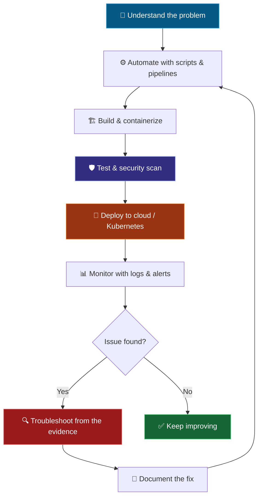
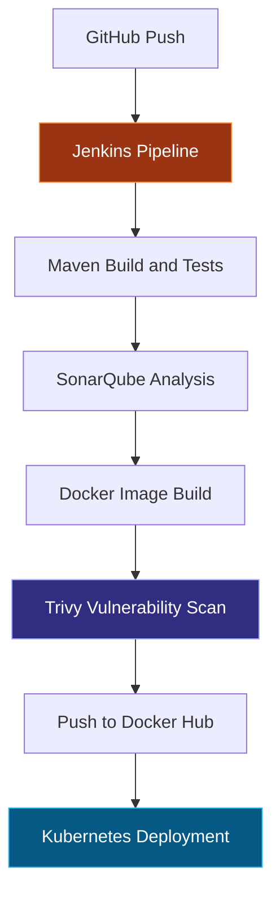
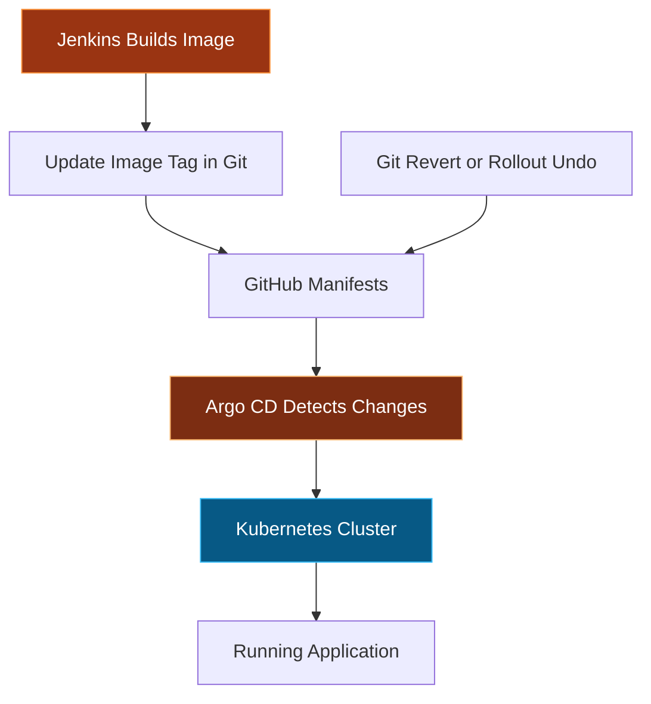
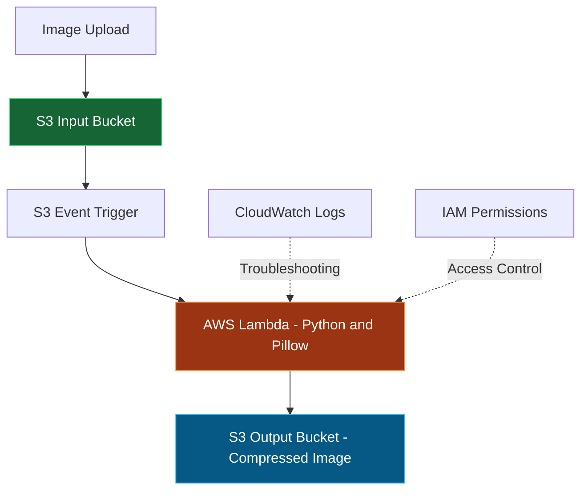
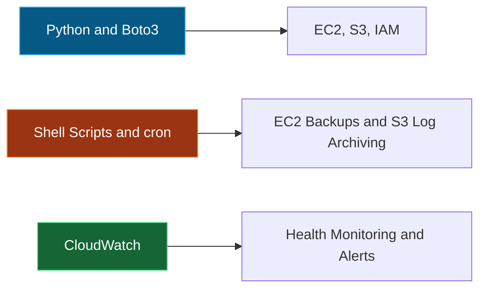

<!-- HERO BANNER -->

 

  

---

#### 👨‍💻 About Me

<h3>
  👋 &nbsp;Hello World! &nbsp;·&nbsp; ☁️ &nbsp;Cloud &nbsp;·&nbsp; ⚙️ &nbsp;DevOps &nbsp;·&nbsp; 🐳 &nbsp;Containers &nbsp;·&nbsp; 🚀 &nbsp;Automation
</h3>

 

 

 

> 👋 **A little about me:** I'm Mohith, a curious and hands-on learner who enjoys understanding how things work behind the scenes. I started with Linux and Git, then moved into AWS, Jenkins pipelines, Docker, Kubernetes, and GitOps by building real projects rather than only reading about them. When something breaks, I like to dig into the logs, find the root cause, and write down the fix so I don't repeat the mistake. I'm now looking for my first role in DevOps or Cloud, where I can keep learning, work with a team, and automate the boring parts of delivering software. ☁️🚀

I'm **Vanticheruku Mohith Reddy**, an aspiring DevOps and Cloud Engineer and a 2026 BCA (Artificial Intelligence) graduate from SDHR Degree College, SV University. I completed DevOps and Cloud training at JSpiders, where I worked with Linux, Git, Jenkins, AWS, Docker, Kubernetes, Terraform, and Ansible.

I like learning by building real projects. So far I have created a DevSecOps CI/CD pipeline with Jenkins, SonarQube, and Trivy, a GitOps deployment using Argo CD and Kubernetes, a serverless image-compression app with AWS Lambda and S3, and Python and Shell scripts that automate everyday AWS tasks. When something breaks, I read the logs, find the root cause, and write down what I learned so the next fix is faster.

I'm looking for an entry-level role as a DevOps Engineer, AWS Cloud Engineer, or Cloud Support Engineer, and I'm open to opportunities across India and to relocation.

<table>
<tr>
<td align="center" width="33%">
 
<b>☁️ Cloud</b> 
EC2 · S3 · IAM · VPC Lambda · CloudWatch
</td>
<td align="center" width="33%">
 
<b>🔄 CI/CD & DevSecOps</b> 
Jenkins · Maven · Git SonarQube · Trivy
</td>
<td align="center" width="33%">
 
<b>🐳 Containers & GitOps</b> 
Docker · Kubernetes Argo CD
</td>
</tr>
<tr>
<td align="center">
 
<b>🐍 Automation</b> 
Python · Boto3 Bash · cron
</td>
<td align="center">
 
<b>🐧 Linux & Troubleshooting</b> 
Permissions · Services Logs · CloudWatch Logs
</td>
<td align="center">
 
<b>🏗️ Infrastructure as Code</b> 
Terraform · Ansible <i>(foundational learning)</i>
</td>
</tr>
</table>

### 🧭 My DevOps Journey

🟩 Completed &nbsp;·&nbsp; 🟦 Currently learning &nbsp;·&nbsp; 🟧 Next goal

### 🔄 How I Work

### 🌱 Currently Learning

### 🎯 What I'm Looking For

**Entry-level DevOps Engineer &nbsp;·&nbsp; AWS Cloud Engineer &nbsp;·&nbsp; Cloud Support**

*Roles where I can learn fast, automate more, and contribute from day one.*

 

💡 *"Automate repetitive work, troubleshoot from the evidence, and document what I learn."*

---

## ⚡ Tech Stack

**☁️ Cloud & OS**

**⚙️ DevOps, CI/CD & Infrastructure**

**💻 Programming & Build Tools**

<strong>📚 Skills by category</strong>

 

| Category | Technologies |
|---|---|
| Cloud | AWS EC2, S3, IAM, VPC, Lambda, CloudWatch |
| Version control | Git, GitHub |
| CI/CD & builds | Jenkins, Maven |
| Containers | Docker, Docker Hub, Kubernetes |
| GitOps | Argo CD, Git-based configuration, deployment rollback |
| DevSecOps | SonarQube, Trivy |
| Scripting | Python, Boto3, Bash, Shell, cron |
| Operating systems | Linux — users, permissions, processes, services, logs |
| Monitoring & troubleshooting | CloudWatch, CloudWatch Logs |
| Infrastructure as Code | Terraform, Ansible *(foundational)* |
| Database | SQL / MySQL |

---

# 🚀 Featured Projects

## 01 · 🛡️ DevSecOps CI/CD Pipeline

**Goal:** Automate the build, code-quality checks, image scanning, and deployment process.

**What I practised**
- Built a multi-stage Jenkins CI/CD pipeline triggered by GitHub pushes.
- Integrated Maven, SonarQube, and Trivy to add quality and security checks before deployment.
- Built and published Docker images, then deployed the application to Kubernetes.

**Stack:** Jenkins · Maven · GitHub · SonarQube · Trivy · Docker · Kubernetes

---

## 02 · 🔁 GitOps Deployment with Argo CD

**Goal:** Manage Kubernetes deployments through version-controlled manifests.

**What I practised**
- Stored Kubernetes manifests in Git and configured Argo CD to monitor and sync changes.
- Connected the Jenkins image-build workflow with manifest image-tag updates.
- Tested recovery using Git commit reverts and `kubectl rollout undo`.

**Stack:** Git · GitHub · Jenkins · Docker · Kubernetes · Argo CD

---

## 03 · 🖼️ AWS Serverless Image Compression

**Goal:** Compress uploaded images automatically without managing servers.

**What I practised**
- Triggered a Python Lambda function when an image was uploaded to S3.
- Used Pillow, packaged as a Lambda layer, and stored results in a separate output bucket.
- Troubleshot `AccessDenied` errors with CloudWatch Logs and tightened IAM permissions to follow least privilege.

**Stack:** S3 · Lambda · Python · Boto3 · Pillow · IAM · CloudWatch

---

## 04 · ☁️ AWS Infrastructure Automation

**Goal:** Reduce repetitive AWS console work with scripts and scheduled automation.

**What I practised**
- Used Python Boto3 to create and delete EC2 instances, S3 buckets, and IAM roles.
- Wrote Shell scripts for scheduled EC2 backups and S3 log archiving using cron.
- Used CloudWatch alerts to monitor instance health.
- Documented VPC components such as subnets, route tables, and security groups.

**Stack:** EC2 · S3 · IAM · VPC · CloudWatch · Python · Boto3 · Bash · cron

---

# 📂 All My Repositories

<!--
  OPTIONAL: Pin your best repos on your profile (Customize your pins) so they appear
  automatically above this README. Only add repo cards below if the repo name is real:

  
-->

---

## 📊 GitHub Stats

 

---

## 🗺️ Learning Roadmap

| Status | Focus area |
|---|---|
| ✅ | Linux administration and Shell scripting |
| ✅ | Git and GitHub fundamentals |
| ✅ | AWS core services and cloud projects |
| ✅ | Jenkins CI/CD and Maven builds |
| 🔄 | Docker and Kubernetes |
| 🔄 | GitOps with Argo CD |
| 🔄 | Terraform and Ansible |
| 🎯 | Deeper AWS networking, monitoring, and troubleshooting |
| 🎯 | AWS certification preparation |

*Status labels reflect my current learning and project practice, not professional certifications.*

---

## 🎓 Education & Training

**Bachelor of Computer Applications — Artificial Intelligence (BCA AI)**
- SDHR Degree College, affiliated with SV University
- Graduation: 2026 · Percentage: 90%

**DevOps and Cloud Training — JSpiders**
- Focus: Linux, Git, Jenkins, AWS, Docker, Kubernetes, Terraform, and Ansible

---

## 🤝 What I Bring to a Team

- 🔍 **Troubleshooting mindset:** Investigate logs and errors to find the root cause.
- ⚙️ **Automation mindset:** Use scripts and pipelines to remove repetitive manual steps.
- 📘 **Continuous learning:** Build real projects to strengthen practical knowledge.
- 📝 **Documentation:** Record configurations, commands, and troubleshooting steps.
- 🤝 **Collaboration:** Comfortable with Git, GitHub, and shared deployment workflows.

---

## 📬 Let's Connect

I'm looking for entry-level opportunities in **DevOps Engineering, AWS Cloud Engineering, CI/CD, and Cloud Support**.

  

**Thanks for visiting my profile!**

*Dream • Learn • Build • Automate • Improve*

